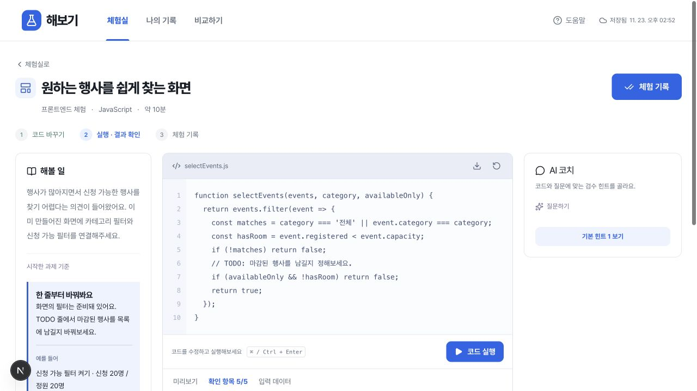
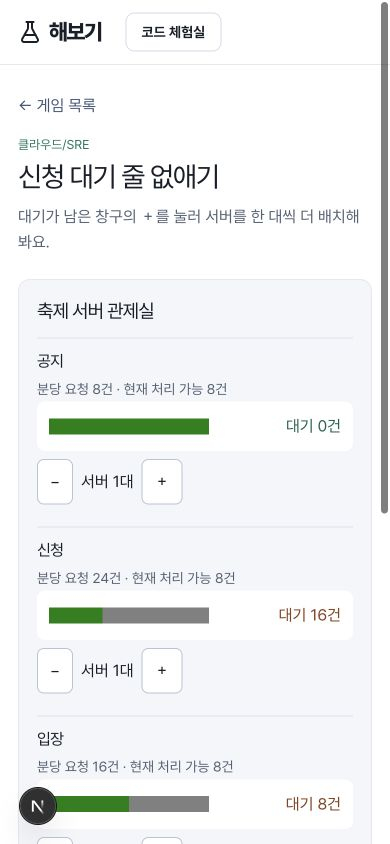
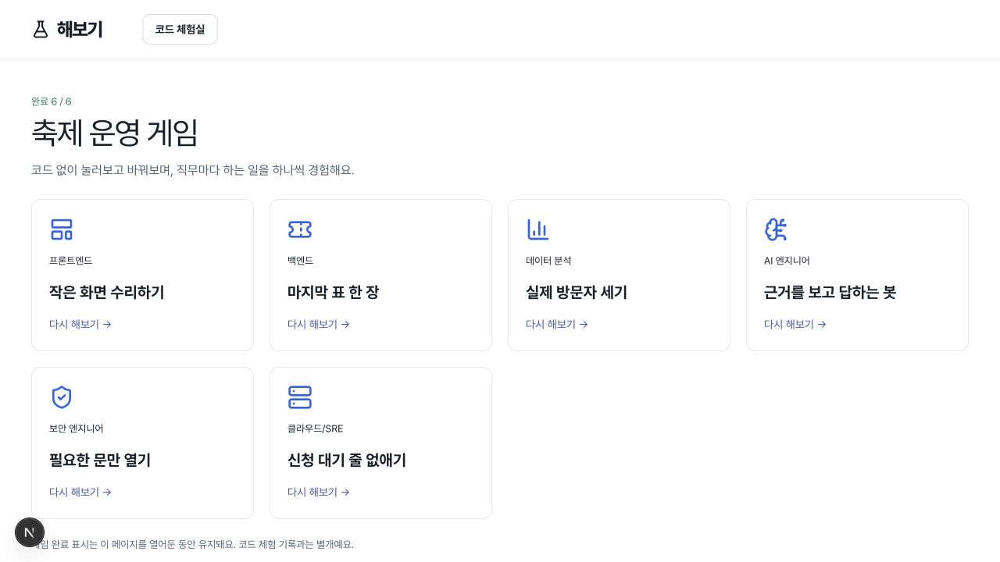

# 처음 접하는 학생을 위한 체험 보완

여섯 직무 게임과 코드 체험의 첫 행동·실패 안내·결과 읽기를 보완합니다. 학생 파일럿으로 난이도 개선 효과를 측정한 결과는 아니며, 이번에는 기술 검사와 브라우저 동작을 검증했습니다.

## 코드 체험

새 시작은 콘텐츠 `2026-11-23.2`를 사용합니다. 주변 로직을 준비하고 핵심 조건 한 줄을 직접 바꿉니다. 기존 다섯 가지 상황, 참고 풀이, 요구 조건, 힌트·AI 검수 문장과 근거 ID는 유지합니다.

| 직무 | 이번에 직접 바꾸는 부분 | 준비해 둔 부분 |
| --- | --- | --- |
| 프론트엔드 | 마감된 행사를 남길지 결정 | 카테고리 필터와 남은 자리 계산 |
| 백엔드 | 정원과 인원이 같을 때도 마감 처리 | 중복 확인과 응답 형식·상태 코드 |
| 데이터 | 유효 신청 대비 실제 참여율 | 취소·중복 제거와 카테고리별 집계 |
| AI | 겹치는 단어가 0개인 문서 제외 | 중복 단어 처리, 점수·동점 정렬, 상위 두 문서 선택 |
| 보안 | 관리자 예외를 조회에만 적용 | 로그인·본인 확인과 거절 응답 |
| 클라우드 | 오류·지연 중 하나만 나빠져도 되돌리기 | 관측 수 확인과 오류율 계산 |

‘한 줄부터 바꿔봐요’에 첫 행동과 작은 입력→결과 예시를 표시합니다. ‘바꿀 줄 찾기’는 실제 편집 줄을 선택하며 코드를 자동 수정하지 않습니다. ‘먼저 그대로 실행해보기’로 현재 동작부터 볼 수 있고, 준비 코드만 실행해서는 직접 수정한 체험으로 기록되지 않습니다.

실패하면 첫 실패 상황을 펼치고 입력·기대 결과·나의 결과를 짧게 보여줍니다. 행사 제목, 참여율, 접근 허용·거절처럼 직무 맥락으로 읽을 수 있고 원본 JSON은 ‘입력·반환값 자세히’에 보존합니다. 예상하지 못한 사용자 반환값도 제한된 문자열로 안전하게 표시합니다.

소요 시간 ‘약 10분’은 새 범위에 맞춘 안내용 추정입니다. 실제 학생 소요 시간을 측정한 수치가 아닙니다. 모든 확인 항목을 통과하지 않아도 수정·실행 후 회고를 남길 수 있고, 적성 점수나 직무 능력 판정으로 사용하지 않습니다.

## 게임 체험

원래의 여섯 게임을 유지하면서 조작 순서와 실패 이유를 구체화했습니다.

- 프론트엔드: 큰 글자·120px 너비·줄바꿈을 단계별로 확인하고 너비를 맞추는 버튼을 제공합니다.
- 백엔드: 두 사람이 동시에 신청하는 상황을 한 번에 관찰한 뒤, 한 사람씩 처리하는 방식으로 직접 진행합니다. 다른 창구를 기다리게 하는 이유와 현재 처리 단계를 보여줍니다.
- 데이터: 이름·시각별로 어느 중복 체크를 꺼야 하는지 안내하고, 첫 기록을 잘못 뺀 경우도 구분합니다.
- AI: 공지를 먼저 고른 뒤 시간·장소를 선택합니다. 공지를 바꾸면 이전 답변을 초기화하고 행사·주차·답변의 불일치를 따로 안내합니다.
- 보안: 각 사람의 필요 자료를 행마다 안내하고, 잘못 열린 자료나 아직 잠긴 자료를 사람·자료 이름으로 알려줍니다.
- 클라우드: 현재 처리 가능 요청 수와 대기를 같이 보여주며 어느 창구의 ＋를 눌러야 하는지 안내합니다.

완료 뒤에는 실제로 해본 일을 한 문장으로 연결하고 다시 해보기·다른 직무 선택을 제공합니다. 모바일에서도 게임 선택·완료·목록 이동 때 화면 위로 이동해 첫 안내가 보입니다. 게임 완료 표시는 페이지를 열어둔 동안만 유지되며 서버의 코드 체험 기록과 합치지 않습니다. 게임은 고정된 상황을 조작하는 시뮬레이션이고 실제 서버 배포·권한 변경·AI 모델 호출을 하지 않습니다.

## 버전과 기존 기록

`2026-11-23.1.ts`와 기존 추천 규칙 파일은 수정하지 않았습니다. 새 파일과 파일·의미 해시를 등록했으며 `LEGACY_CONTENT_VERSION`은 그대로입니다. 검수 날짜는 이번 구현의 조건·해답·힌트 대조 및 자동 검사에 근거하며 별도 학생 파일럿이나 외부 검수를 뜻하지 않습니다.

기존에 시작한 체험은 해당 버전의 코드·테스트·힌트·시간 안내를 그대로 사용합니다. 새 한 줄 시작 코드는 새 체험에만 적용하고, 이전 진행을 강제로 전환하거나 초기화하지 않습니다. 결과를 읽기 쉽게 표시하는 화면 보완은 기존 체험에도 적용됩니다. 저장 상태·초안 복구·삭제·추천 기록 동작은 유지합니다.

## 검증

- 자동 검사 **133개**: 기존 118개 + 새 시작 코드/기존 버전 7개, 게임 규칙 6개, 결과 설명 2개.
- 여섯 새 시작 코드가 실제로 미완성이며, 한 줄 수정으로 원래 다섯 상황을 모두 통과하는지 각각 실행했습니다. 기존 풀이·테스트·힌트·근거가 변하지 않았는지 대조했습니다.
- 게임은 입장 체크 32개, 공지/시간/장소 64개, 권한 조합 512개, 서버 배치 343개와 두 가지 안전 처리 순서를 검증했습니다. 제한을 풀면 실제로 표 두 장이 나가는 시뮬레이션도 확인했습니다.
- 브라우저에서 여섯 게임의 잘못된 선택→안내→수정→완료 흐름을 확인했습니다. 프론트엔드·데이터 코드의 줄 찾기→직접 한 줄 수정→5/5→체험 기록 활성화, 새로고침 후 코드·실행 결과·버전 유지도 확인했습니다. 390px 모바일에서 게임 조작·목록 이동을 확인했습니다.
- API로 새 버전과 보존 버전의 동시 저장·조회, 알 수 없는 버전 보존, 추천 저장과 기록 관리 회귀를 확인했습니다. 별도 SQLite 테스트 저장소의 임시 기록만 사용했습니다.
- 타입 검사·프로덕션 빌드 확인. 실제 AI 호출이나 기존 AI 선택 평가 전체 재실행은 이번 범위에 포함하지 않습니다.

```sh
npm test
npm run build
npm run typecheck
LAB_TEST_URL=http://127.0.0.1:3002 node tests/api-smoke.mjs
LAB_TEST_URL=http://127.0.0.1:3002 node tests/next-actions-api.mjs
LAB_TEST_URL=http://127.0.0.1:3002 node tests/record-management-api.mjs
```

다음에는 학생에게 설명 없이 첫 체험을 맡겨 처음 누르는 버튼, 막힌 지점, 도움 사용, 체험 후 직무 이해를 관찰해야 합니다. 이번 변경만으로 ‘쉬워졌다’는 사용자 검증을 완료한 것으로 취급하지 않습니다.






