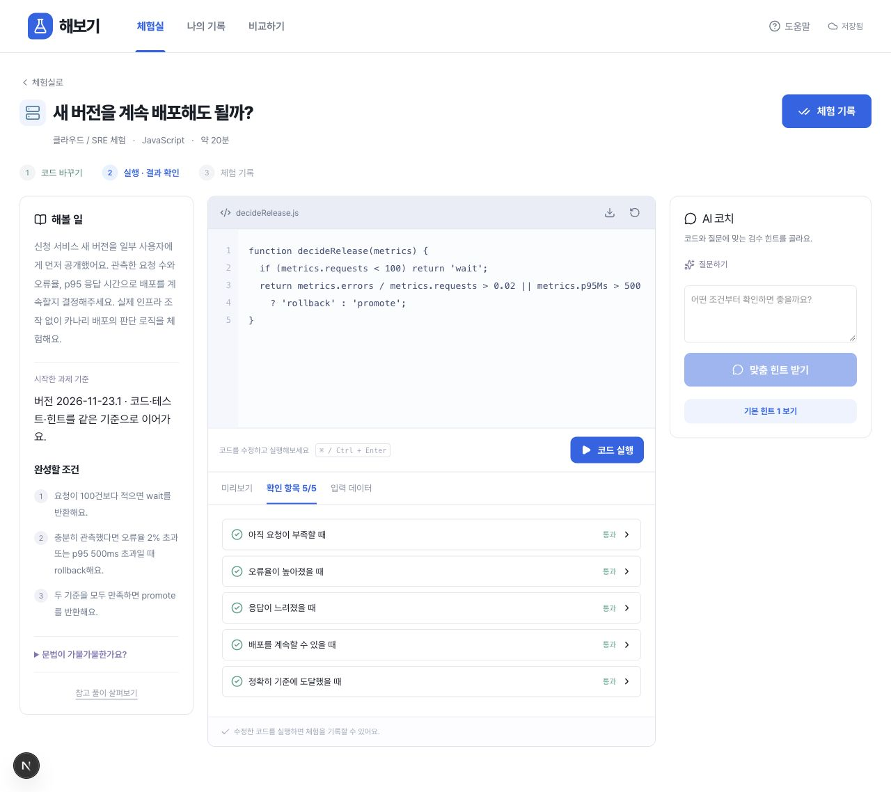

# 미션 콘텐츠 버전과 기존 기록

## 시작한 과제를 유지하기

이슈 #2의 P1-1을 반영합니다. 저장 형식 `LabState.version`과 `Progress.version`은 계속 `1`이고, 과제 내용은 별도의 `contentVersion`으로 식별합니다. 현재 새 시작 버전은 `2026-11-23.2`입니다. `2026-11-23.1`은 기존 체험과 버전 없는 기록의 보존 기준으로 유지합니다.

`lib/content/2026-11-23.1.ts`에 여섯 직무의 시작 코드·참고 풀이·조건·입력·테스트·단계별 힌트·검수 AI 안내 문장을 함께 보관합니다. 기존 develop `598fe4d`의 미션·테스트·힌트·AI 안내와 정확히 같은 내용임을 대조했고, 전체 의미와 파일의 SHA-256을 `lib/content/manifest.json`에 기록했습니다. 실행 중에는 등록한 정의를 깊게 동결합니다.

새 체험에는 콘텐츠 버전과 `started` 출처를 저장합니다. 이어하기, 브라우저 실행, 프론트엔드 예시 입력, 기본 힌트, 참고 풀이, AI 도구와 응답이 모두 그 버전을 조회합니다. 실행 스냅샷에는 버전과 미션 ID를 함께 기록하고 회고가 그 스냅샷을 참조합니다. 버전이 다른 실행은 현재 결과나 완료 근거로 사용하지 않습니다.

기록·비교에는 시작한 과제의 정의와 기록한 실행을 사용합니다. 버전 정보가 없는 과거 실행을 새 버전에서 실행했다고 소급해서 표시하지 않습니다.

## 새 버전과 운영 상태

카탈로그는 `lib/mission-catalog.ts`에서 관리합니다.

- `reviewStatus: reviewed`와 검토 날짜가 있어야 체험·이어하기의 정의로 사용할 수 있습니다. `draft`는 새 시작과 실행을 허용하지 않습니다. 검토 상태는 저장 형식 버전과 별개입니다.
- `acceptingNewStarts: false`는 해당 릴리스의 새 시작을 중단합니다. 기존에 시작한 검수 버전의 이어하기는 유지합니다.
- `pausedMissionIds`는 특정 직무의 새 시작만 중단할 때 사용합니다. 다른 직무와 기존 진행 기록에는 적용하지 않습니다.
- 화면은 새 시작 중단을 표시하고, 기존 기록은 이어하기로 엽니다. 검수 상태와 시작 중단은 운영자가 소스에서 설정하는 정책이며 관리자 화면은 포함하지 않습니다.

내용을 고칠 때 기존 릴리스 파일을 덮어쓰지 않습니다. 새 파일·버전을 만들고 새 조건·테스트·힌트·근거를 함께 검수한 후 등록합니다. 이전 버전은 카탈로그에서 제거하지 않습니다. 활성 카탈로그의 직무 항목도 삭제하는 대신 새 시작 중단을 사용해야 기존 진행 화면의 진입점을 유지할 수 있습니다. `LEGACY_CONTENT_VERSION`은 최초 보존 버전에 고정하며 최신 버전을 가리키도록 바꾸지 않습니다. 새 릴리스의 자동화 검사와 실질적인 내용 검토 후 `reviewed`로 전환해야 하며, 날짜가 있다는 사실만으로 사람의 별도 검수가 끝났다고 주장하지 않습니다.

알 수 없는 버전이나 검수 전 버전은 최신 과제로 대체하지 않습니다. 코드·회고를 보존하고 읽기·내려받기 화면으로 안내하며, 실행·힌트·참고 풀이를 적용하지 않습니다. 복구하려면 해당 검수 버전을 배포에 다시 등록해야 합니다.

## 기존 기록 이전 정책

기존의 여섯 미션 내용과 같은 보존 버전을 만들었으므로, 버전 필드 없는 진행 기록은 `2026-11-23.1`로 이어갈 수 있게 하되 출처를 `legacy_baseline`으로 구분합니다. 코드·도움 단계·회고·기존 실행 결과는 삭제하지 않습니다.

과거 실행·회고에 버전 필드를 덧붙이지 않습니다. 과거 회고는 ‘이전 기록 · 과제 기준 미확인’으로 보존하고, 버전 근거가 확인된 완료 비교에는 포함하지 않습니다. 다시 수정·실행하면 그때부터 버전이 있는 실행을 기록할 수 있습니다. 테스트가 일부 실패해도 직접 수정·실행과 회고를 기록하는 원칙은 유지합니다.

저장 요청에서 이미 시작한 버전을 다른 버전으로 바꾸거나 진행 항목을 누락하면 409로 거절하고 기기 초안을 유지합니다. 정상적인 편집·레거시 기준 이전은 허용합니다. 전체 삭제는 별도의 DELETE 동작을 사용합니다. 이 검사는 일반적인 저장 요청의 버전 교체를 막으며, 전체 기록의 다중 탭 동시 편집을 병합하는 기능은 아닙니다.

AI 요청의 버전이 저장된 진행과 다르거나 등록된 검수 버전이 아니면 409로 거절합니다. 이 경우 한도를 예약하거나 외부 AI를 호출하지 않습니다. 버전 필드가 없는 구형 AI 클라이언트는 보존 기준 버전만 참조하며 최신 버전으로 자동 전환하지 않습니다. 구형 클라이언트가 새 버전의 기록을 덮어쓰려는 요청도 거절합니다.

## 초기 버전 도입 당시 검증(PR #31)

- 자동 테스트 77개: 기존 65개에 버전·시작 중단·검수·불변성·기록 이전·알 수 없는 버전·AI 기준·저장 버전 충돌 등 12개 추가.
- 테스트 전용 v2에서 규칙을 실제로 바꿔 새 시작의 반환값은 바뀌고, 기존 세션의 코드·입력·테스트·힌트·반환값은 그대로인지 확인합니다. 가짜 v2는 운영에 등록하지 않습니다.
- API 검증: 버전 저장·조회, 다른 버전 저장 거절, 알 수 없는 버전의 코드 보존, AI 409와 임시 기록 삭제 확인.
- 실제 OpenAI 연결: `source: ai`, `intent: rules`, `contentVersion: 2026-11-23.1`과 해당 버전의 검수 힌트·근거 반환 확인.
- 브라우저: 시작 버전 표시, 코드 수정·실행 5/5, 새로고침 후 코드·결과·버전 유지 확인.
- TypeScript 검사와 배포용 빌드 검증.

이전 PR의 실제 모델 선택 평가 72/72·추가 질문 32/32는 당시 구현 해시의 기록으로 보존합니다. 이번에는 콘텐츠가 동일함을 대조하고 버전 연결 회귀와 실제 API 스모크를 검증했으며, 이전 104회를 이번 구현으로 다시 실행한 결과라고 표현하지 않습니다.

## 한 줄 시작 코드 릴리스 `2026-11-23.2`

여섯 직무의 주변 로직을 준비하고 한 줄의 핵심 조건을 바꾸는 시작 코드를 추가했습니다. 요구 조건·다섯 테스트·참고 풀이·힌트·검수 AI 문장은 원래와 같습니다. 첫 행동·예시·문법 안내와 예상 시간은 새 릴리스에 묶었습니다. 기존 체험의 콘텐츠나 버전은 변경하지 않습니다. 두 릴리스 모두 파일·의미 해시를 대조합니다. [체험 범위와 검증](BEGINNER-EXPERIENCE.md)을 참고하세요.
