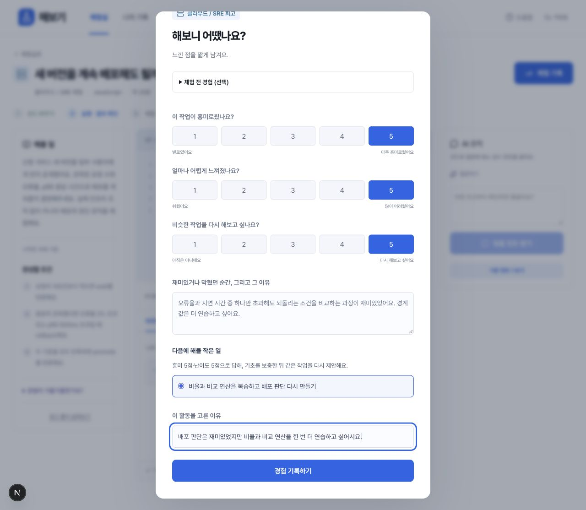

# 회고에 근거한 다음 활동

이슈 #2 P1-2를 보완합니다. AI가 활동을 생성하거나 적성을 판정하지 않습니다. PRD v0.2 09장의 분야 결정표를 현재의 여섯 직무 체험에 적용하고, 검수된 활동 목록에서 제안합니다. 직접·검수·지시의 세 가지 작업 방식 축은 아직 이 구현에 포함하지 않습니다.

## 규칙

흥미(I), 체감 난이도(D), 재도전 의향(R)은 사용자가 입력한 1~5점입니다. 위에서부터 처음 맞는 규칙 하나만 적용합니다.

| 순서 | 조건 | 제안 |
| --- | --- | --- |
| 1 | 점수가 비어 있거나 범위 밖 | 제안 보류, 세 가지 점수 입력 안내 |
| 2 | I ≥ 4, D ≥ 4 | 같은 직무의 기초 보충 + 재체험 |
| 3 | I ≥ 4, R ≥ 4 | 같은 직무의 작은 확장 활동 |
| 4 | I ≥ 4 | 같은 직무의 관련 학습 주제 |
| 5 | I ≤ 3, 아직 마치지 않은 이용 가능한 체험 있음 | 다른 체험 후보를 모두 제시하고 직접 선택 |
| 6 | 여섯 체험 완료, 모두 I ≤ 2 | 학교의 다른 활동도 가볍게 탐색 |
| 7 | 여섯 체험 완료, 그 외 | 흥미를 가장 높게 답한 체험의 확장. 동점 후보는 모두 표시 |
| 8 | 아직 완료하지 않은 체험이 있지만 중단·자료 확인 등의 이유로 이용 불가 | 이번 경험을 정리하는 활동 |

I·D·R이 모두 5점이어도 기초 보충이 먼저입니다. 일부 테스트 실패, 참고 풀이·힌트 사용은 추천을 낮추는 근거가 아닙니다. 버전과 직접 수정·실행 근거가 확인된 회고만 다른 체험의 완료로 셉니다. 비어 있는 회고·기준 미확인 과거 기록을 완료로 추정하지 않습니다.

새 시작이 중단된 직무는 새 후보에서 제외하되, 이미 시작한 검수 버전은 이어갈 수 있습니다. 알 수 없는 버전은 새 체험으로 바꿔 추천하지 않습니다. 여섯 체험을 마친 경우와 다른 체험이 잠시 이용 불가인 경우를 구분합니다.

## 선택과 기록

회고 점수 아래에 제안 이유와 후보를 보여줍니다. 후보는 자동 선택하지 않고 사용자가 선택한 뒤 한 줄 이유(1~300자)를 적습니다. 점수가 바뀌면 이전 선택·이유를 초기화해 새 제안을 확인하게 합니다. 같은 점수를 다시 누르는 것만으로 입력을 지우지는 않습니다.

회고에 다음을 함께 저장합니다.

- 추천 규칙 버전과 과제 콘텐츠 버전
- 기준 실행 ID와 자기 응답 점수
- 선택 당시 완료 체험의 흥미 응답·이용 가능한 다른 체험 목록
- 적용 규칙·설명·제시한 전체 후보
- 사용자가 고른 후보와 직접 적은 선택 이유

다른 체험을 나중에 마쳐도 과거 제안은 다시 계산해 덮어쓰지 않습니다. 기존의 자유 입력 다음 활동은 보존하며 새 추천 근거나 이유를 지어내지 않습니다. 기존 회고를 다시 저장할 때는 현재 기준의 제안을 사용자가 다시 확인합니다.

서버는 후보·설명이 등록된 규칙으로 재현되는지, 선택이 후보 안에 있는지, 제목·점수·실행·미션 버전이 회고와 맞는지 검사합니다. 다른 과제 버전이 일시적으로 없어도 알려진 추천 규칙의 과거 기록은 보존하고, 확인된 완료 비교에는 넣지 않습니다. 이 데이터는 사용자의 자기 응답에 근거하며 서버가 코드를 실행하거나 흥미를 객관적으로 측정했다는 뜻이 아닙니다.

`lib/next-actions-v1.ts`와 `lib/next-actions-manifest.json`이 현재 규칙을 보존합니다. 규칙·후속 활동을 바꾸려면 새 버전 파일을 만들고 `lib/next-actions.ts`의 규칙 레지스트리에 이전 버전을 유지해야 합니다. 같은 버전 파일을 덮어쓰면 과거 기록의 검증 기준이 달라지므로 체크섬 테스트가 실패합니다.

비교는 확인된 회고 두 개 이상일 때만 제공합니다. 흥미를 가장 높게 답한 체험의 저장된 다음 활동과 선택 이유를 보여주고, 동점은 모두 표시합니다. 대표 활동을 자동 확정하거나 직무 적성 순위를 만들지 않습니다. 데이터 분석 회고에는 눈여겨본 집계 수치와 다음 행사 개선안을 함께 적도록 안내하며, 자유 서술의 수치가 실제 결과와 일치한다고 자동 인증하지 않습니다.

## 검증 범위

- 자동 테스트 97개(기존 77개 + 추천 관련 20개)
- 직무별 I·D·R 125가지, 총 750가지 점수 조합과 우선순위 검사
- 미응답, 동점 여섯 개, 기록 부족, 전부 낮은 흥미, 중단/기존 버전/알 수 없는 버전 검사
- 도움·테스트 실패를 감점하지 않는지, 두 회고 미만 비교 보류 검사
- 후보·선택·점수·실행 근거 변조 거절, 기존 자유 입력과 과거 제안 보존 검사
- 실제 저장 API: 후보·선택 이유 보존, 잘못된 계획 400, 다른 진행 추가 후 과거 계획 유지, 임시 기록 삭제
- 브라우저: 규칙 우선순위, 점수 변경 시 선택 초기화, 명시적 선택·이유 입력, 저장/새로고침 후 보존 확인

```sh
npm test
npm run typecheck
npm run build
LAB_TEST_URL=http://127.0.0.1:3000 node tests/next-actions-api.mjs
```


